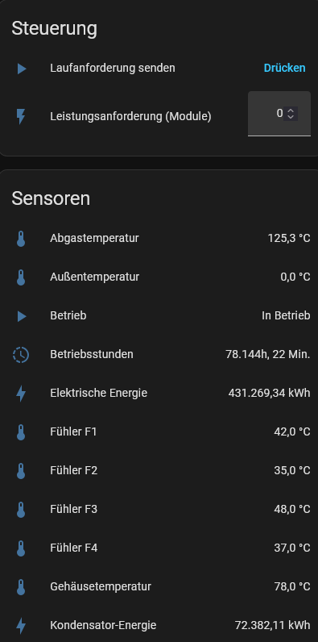

# SenerTec Dachs for Home Assistant

Read temperatures, power, energy, and runtime from a SenerTec Dachs in
Home Assistant. MSR2 users can also request a run or set power demand.

<!-- ha-marketplace:exclude-start -->
## Install

### Home Assistant 2026.11 or newer: Marketplace

Marketplace comes with Home Assistant. You do not need to install HACS.

Use the button above, or add the repository yourself:

1. In Home Assistant, open **Settings → Marketplace**.
2. Select **Add from link** in the top right.
3. Paste `https://github.com/skuzait/senertec-dachs-homeassistant` and
   select **Add**. Choose **Integration** if asked for a type. Connect
   your GitHub account if prompted.
4. Open **SenerTec Dachs** and select **Install**.

See the [Home Assistant Marketplace guide](https://www.home-assistant.io/integrations/marketplace/#custom-repositories)
if you need help adding a repository.

### Home Assistant 2025.4 through 2026.10: HACS

If HACS is not installed, follow the [HACS installation guide](https://www.hacs.xyz/docs/use/download/download/).

1. Open **HACS** from the Home Assistant sidebar.
2. Select the three dots in the top right, then select **Custom repositories**.
3. Paste `https://github.com/skuzait/senertec-dachs-homeassistant`, choose
   **Integration** as the type, and select **Add**.
4. Open **SenerTec Dachs** in HACS and select **Download**.
5. Restart Home Assistant.

### Manual install

Download the `dachs` ZIP from [Releases](https://github.com/skuzait/senertec-dachs-homeassistant/releases).
Extract the `dachs` folder into `custom_components` in your Home Assistant
configuration directory. Check that `custom_components/dachs/manifest.json`
exists, then restart Home Assistant.
<!-- ha-marketplace:exclude-end -->

## Set up your Dachs

If installation opens the setup form, pick a connection there. Otherwise,
restart Home Assistant if prompted, then open **Settings → Devices & services
→ Add integration** and search for **SenerTec Dachs**. Home Assistant
installs the [Python library](https://github.com/skuzait/senertec-dachs)
for you.

| Connection | What to enter |
| --- | --- |
| Local: detect MSR2 or MSR3 automatically | Your Dachs IP address. Add the GLT password if your MSR2 needs one. |
| Local: MSR2 (HTTP) | Your Dachs IP address and GLT credentials. The default username is `glt` and the default port is 8080. |
| Local: MSR3 / Gen2 (Modbus TCP) | Your Dachs IP address. The default port is 502. No PIN is needed to read values. |
| Cloud: Dachsportal / DachsApp (old portal) | The portal ID (the last part of the serial number) and your DachsApp password. |

For a local connection, enable GLT on the controller first. On MSR3 the
setting is NP221. MSR3 is **experimental** and only supports reading in
Home Assistant. I still need a Gen2 unit to test it on. If you have one,
please [get in touch](https://github.com/skuzait/senertec-dachs-homeassistant/issues).

The newer DachsConnect portal (DachsPortal2) is not available in this
release.

## Sensors and controls

MSR2 and the older Dachsportal report power, energy totals, runtimes,
starts, temperatures, and maintenance status. The available readings
depend on the unit and connection. MSR3 reports a smaller set that
includes power, energy, runtime, and the main temperatures.

On MSR2 and the older Dachsportal, **Request run** sends the same command
as the button in the DachsApp. **Power demand (modules)** accepts 0 to 10
modules. The request expires after ten minutes unless renewed.

## Good to know

* Local connections poll every 30 seconds by default. The older portal
  polls every 120 seconds. You can change the interval during setup.
* Dachsportal can return readings several minutes old. Check **Device
  online** and **Data fetched at** before using those values in automations.
  The portal does not have a public API, so changes on SenerTec's side
  can break the cloud connection.
* Local HTTP (MSR2) and Modbus TCP (MSR3) are not encrypted. Keep them on
  your local network and do not forward ports 8080 or 502 to the internet.

## License

[MIT](LICENSE)
